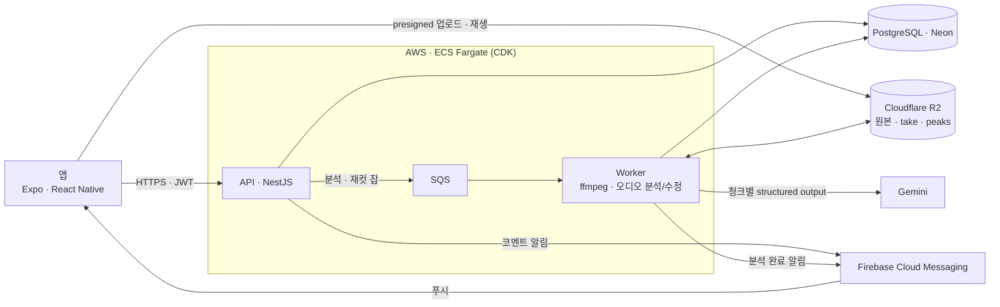
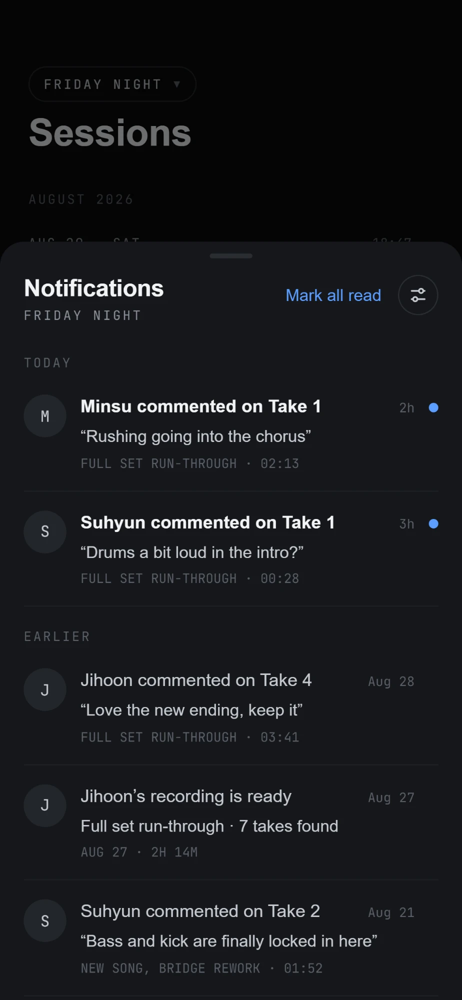
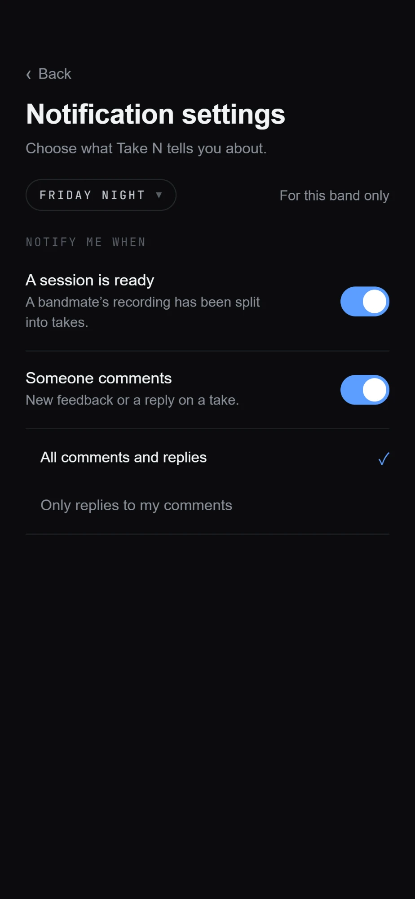

# Take N

밴드 합주를 녹음하려면 곡이 시작하고 끝날 때마다 녹음을 껐다 켜야 하고, 그게 귀찮아서 한 번에 녹음해 두면 나중에 연주 구간을 찾기 어렵다.

Take N은 합주 전체를 녹음해서 올리면 연주 구간(take)만 잘라서 정리해 주는 앱이다. 곡 단위로 잘린 take에 멤버들이 코멘트를 남기며 피드백을 주고받는다.

- Android, iOS 지원
- 스토어 심사 준비 중
- 2026년 8월부터 개발
- 1인 개발

## 기술

- 앱: React-native(Expo), TypeScript
- 서버: NestJS, PostgreSQL (Neon), Drizzle ORM, SQS, Gemini, ffmpeg.
- 인프라: AWS ECS Fargate, ALB, SQS, SSM Parameter Store, CDK (TypeScript), Cloudflare R2
- 개발 환경: Turborepo 모노레포, Docker Compose + LocalStack, Vitest

## 고민했던 것

- **긴 오디오는 청크로.** 긴 시간의 오디오 파일을 한 번에 보내면 시간과 토큰이 감당이 안 된다. 20분 청크에 앞뒤 30초 겹침을 두고 청크마다 JSON 스키마로 take 후보를 받은 뒤, 겹침 구간에서 중복을 병합한다.
- **경량 모델로 분석 비용을 줄여 보려 했다.** Gemini에 오디오를 통째로 보내면 시간당 비용이 그대로 쌓이므로, YAMNet, PANNs 같은 사전학습 오디오 분류기로 음악/비음악을 먼저 가르는 방법을 시도했다. 모델 7개(DSP 베이스라인, YAMNet, PANNs CNN14, AST, CLAP, Silero VAD, inaSpeechSegmenter)를 같은 녹음에 돌려 각 모델이 어느 구간을 연주로 봤는지 한 페이지에서 비교하는 Python 스크립트를 만들었다. 실제 합주 녹음으로 돌려 보니 연주 구간과 그 밖의 소리가 기대만큼 갈리지 않았다. MVP 단계라 여기에 더 시간을 쓰지 않고 Gemini에 오디오를 직접 넣는 쪽으로 갔다.

## 구조

분석 순서: R2 다운로드 → ffmpeg 20분 청크(앞뒤 30초 겹침) → 청크별 Gemini 분석 → 겹침 병합 → take 절단 → 피크 추출(초당 50개, `peaks.bin`) → R2·DB 반영

---

### 폴더 구조

- `apps/mobile` — 앱 (Expo)
- `apps/api` — API 서버와 분석 워커 (NestJS)
- `apps/audio-worker` — Python 워커 자리 (경량 모델 전처리용, 아직 뼈대)
- `packages/types` — 앱과 서버가 공유하는 타입
- `packages/api-client` — API 호출 클라이언트
- `poc/` — 분석 모델 비교 코드
- `infra/` — AWS CDK 스택

## 주요 기능 및 화면

- 회원 가입·로그인: Apple, Google
- 녹음·가져오기: 앱에서 녹음하거나 m4a를 가져온다. 끊긴 업로드는 남은 부분만 이어서 올린다
- AI 분석: 연주 구간만 잘라 take를 만들고 파형을 뽑는다
- 타임라인: 원본 전체에서 take 위치를 보고 팬·줌·재생
- take 편집: 경계 수정(서버에서 다시 자름), 수동 추가, 삭제, 이름 변경
- 피드백: take와 원본에 시간 위치가 붙은 코멘트, 답글
- 알림: 코멘트·분석 완료 푸시와 인박스, 밴드별 알림 설정
- 밴드: 초대 링크, 파트, 소유권 이전, 멤버 내보내기
- 구독·결제: 월 분석 시간 플랜과 추가 시간, 여러 밴드가 한 풀을 공유 (인앱 결제)
- 한국어·영어

|                                                                          |                                                                     |
| ------------------------------------------------------------------------ | ------------------------------------------------------------------- |
|                      |               |
| **녹음** 합주를 그대로 녹음한다. 멈추면 바로 업로드와 분석이 이어진다.   | **세션 목록** 분석이 끝나면 take 수, 길이, 코멘트 수가 보인다.      |
|               |               |
| **세션 상세** AI가 잘라낸 take 목록. 파형은 실제 오디오 피크.            | **타임라인** 원본 전체 위에서 take 위치를 보고, 팬·줌·재생.         |
|                   |          |
| **take 편집** 핸들을 끌거나 시간을 입력해 경계를 고친다. 수동 take 추가. | **take 피드백** 시간 위치가 붙은 코멘트와 답글.                     |
|               |  |
| **알림** 코멘트와 분석 완료를 인박스와 푸시로 받는다.                    | **알림 설정** 밴드별로 받을 알림을 고른다.                          |
|                        |                   |
| **밴드** 멤버와 파트, 초대, 소유권 이전.                                 | **플랜·사용량** 월 분석 시간과 추가 시간. 여러 밴드가 한 풀을 쓴다. |
