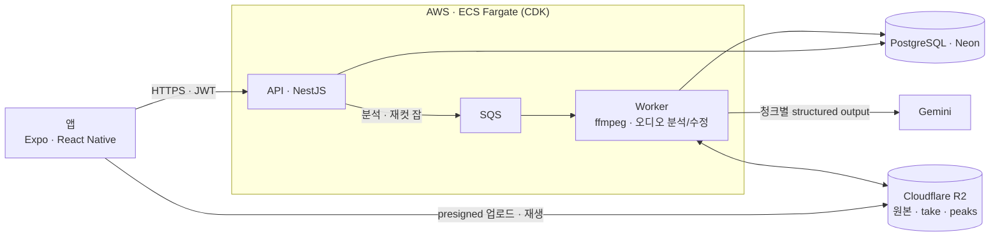

# Take N

밴드 합주를 녹음하려면 곡이 시작하고 끝날 때마다 녹음을 껐다 켜야 하고, 그게 귀찮아서 한 번에 녹음해 두면 나중에 연주 구간을 찾기 어렵다.

Take N은 합주 전체를 녹음해서 올리면 연주 구간(take)만 잘라서 정리해 주는 앱이다. 곡 단위로 잘린 take에 멤버들이 코멘트를 남기며 피드백을 주고받는다.

- Android, iOS 지원
- 스토어 심사 준비 중
- 2026년 8월부터 개발
- 1인 개발

## 기술

- 앱: React-native(Expo), TypeScript
- 서버: NestJS, PostgreSQL (Neon), Drizzle ORM, SQS, Gemini, ffmpeg.
- 인프라: AWS ECS Fargate, ALB, SQS, SSM Parameter Store, CDK (TypeScript), Cloudflare R2
- 개발 환경: Turborepo 모노레포, Docker Compose + LocalStack, Vitest

## 구조

분석 순서: R2 다운로드 → ffmpeg 20분 청크(앞뒤 30초 겹침) → 청크별 Gemini 분석 → 겹침 병합 → take 절단 → 피크 추출(초당 50개, `peaks.bin`) → R2·DB 반영

---

### 폴더 구조

- `apps/mobile` — Expo(React Native) 앱
- `apps/api` — NestJS API와 분석 워커 (`api.main.ts` / `worker.main.ts`, 같은 이미지)
- `apps/audio-worker` — Python 분석 워커 뼈대 (JS 워크스페이스 밖, 자체 pyproject). 검출기 전처리 자리
- `packages/types` — mobile ↔ api 공유 타입 (유일한 공유 지점)
- `packages/api-client` — API 클라이언트
- `packages/config` — 공유 tsconfig/prettier 프리셋
- `poc/` — Phase 0 오디오 세그멘테이션 실험 하네스 (독립)
- `infra/` — AWS CDK 스택과 ECR 푸시 스크립트

## 설계에서 정한 것

- **긴 오디오는 청크로.** 3시간 파일을 한 번에 보내면 시간과 토큰이 감당이 안 된다. 20분 청크에 앞뒤 30초 겹침을 두고 청크마다 JSON 스키마로 take 후보를 받은 뒤, 겹침 구간에서 중복을 병합한다. 응답은 파싱 뒤에도 시작 < 끝, 종류 enum을 다시 검증한다.
- **오디오는 API를 거치지 않는다.** 앱이 presigned URL로 R2에 직접 올리고, 워커가 R2에서 받아 처리한다. API 서버는 메타데이터와 큐만 다루므로 작은 인스턴스 하나로 충분하고, 업로드 대역폭 비용이 API에 붙지 않는다.
- **워커는 Fargate Spot.** 중단돼도 처리 중이던 메시지가 가시성 타임아웃 뒤 SQS에 다시 나타나고 새 컨테이너가 이어받는다. 결과가 달라지지 않으니 싼 쪽을 쓴다. 요청을 받는 API만 온디맨드.

## 어려웠던 문제

- **Reanimated 4.5 + Fabric.** JS에서 runOnUI로 바꾼 shared value가 useAnimatedStyle 뷰에 가끔 반영되지 않아 타임라인을 열면 playhead가 0, take 레인이 비어 있었다. 제스처로 바꾼 값은 항상 정상이고 한 번 건드리면 풀린다. 원인은 못 좁혔고, JS가 값을 바꾼 횟수를 세어 해당 뷰를 120ms 뒤 key로 다시 붙이는 우회를 넣었다. 다시 붙을 때 Reanimated가 현재 shared value로 style을 강제 재적용하는 점을 이용한 것이다. 라이브러리를 올려 사라지면 걷어낸다.
- **3시간 파형을 폰에서 60fps로.** 상태 기준을 픽셀이 아니라 timeMs 하나로 두고, 뷰포트와 playhead를 shared value로 올려 파형 SVG path를 UI 스레드에서 만든다. 제스처·재생 중 React 리렌더가 없다. 피크는 워커가 초당 50개로 뽑아 두고 앱에서 LOD 피라미드를 만들어 줌 레벨마다 바당 피크 1~3개만 그린다.
- **Windows에서 Android 빌드.** CMake가 쓰는 ninja가 긴 경로 설정을 무시해 네이티브 빌드가 깨졌다. 프로젝트를 짧은 드라이브 문자에 매핑해 gradle은 그쪽에서, Metro는 원래 경로에서 돌리는 식으로 해결했다.

## 주요 기능

|                                                                          |                                                                     |
| ------------------------------------------------------------------------ | ------------------------------------------------------------------- |
|                      |               |
| **녹음** 합주를 그대로 녹음한다. 멈추면 바로 업로드와 분석이 이어진다.   | **세션 목록** 분석이 끝나면 take 수, 길이, 코멘트 수가 보인다.      |
|               |               |
| **세션 상세** AI가 잘라낸 take 목록. 파형은 실제 오디오 피크.            | **타임라인** 원본 전체 위에서 take 위치를 보고, 팬·줌·재생.         |
|                   |          |
| **take 편집** 핸들을 끌거나 시간을 입력해 경계를 고친다. 수동 take 추가. | **take 피드백** 시간 위치가 붙은 코멘트와 답글.                     |
|                        |                   |
| **밴드** 멤버와 파트, 초대, 소유권 이전.                                 | **플랜·사용량** 월 분석 시간과 추가 시간. 여러 밴드가 한 풀을 쓴다. |

서버: 알림 — 코멘트·세션 완료 인박스(밴드별 설정, 30일), FCM 푸시(`FIREBASE_SERVICE_ACCOUNT_JSON` 없으면 로그만)

앱: 알림 — 하단 Alerts 탭(현재 밴드 인박스), Me › Notifications 설정(밴드별). FCM 푸시는 `GOOGLE_SERVICES_JSON/PLIST`가 있을 때만 빌드에 포함되므로 설정 후 dev client 재빌드가 필요하다. 두 파일이 없으면 iOS/Android 모두 Firebase를 아예 빼고 빌드한다(`apps/mobile/react-native.config.js`가 오토링크를 끈다) — 인박스·설정은 동작하고 푸시만 빠진다
