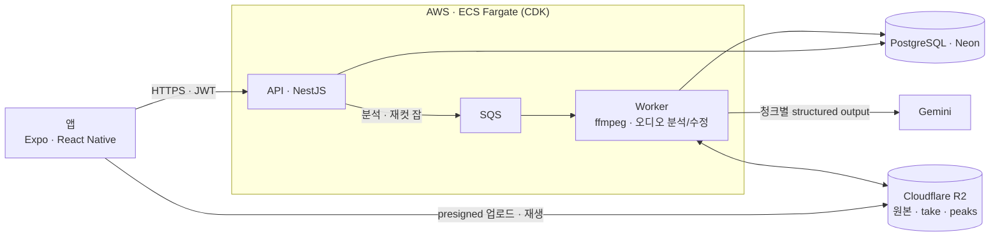
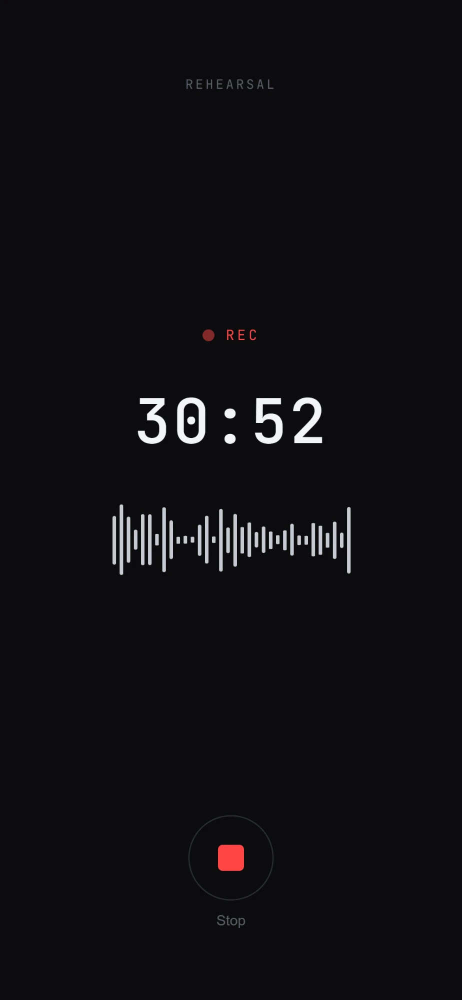
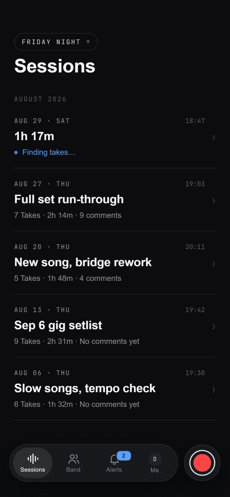
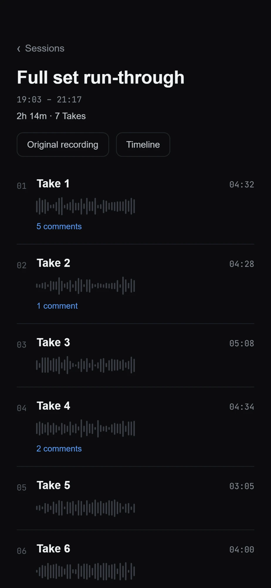
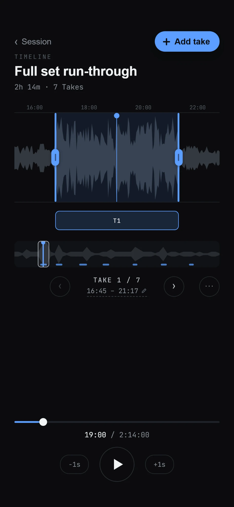
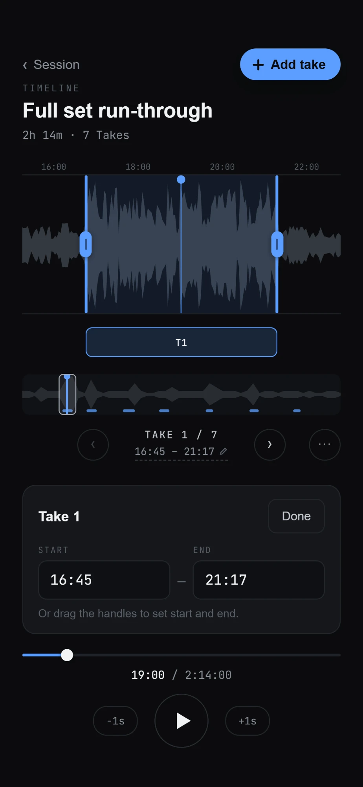
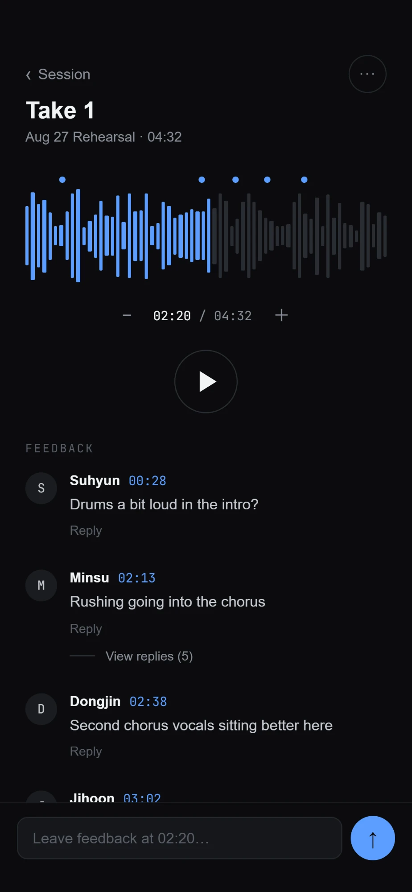
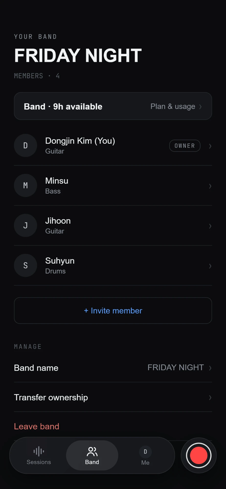
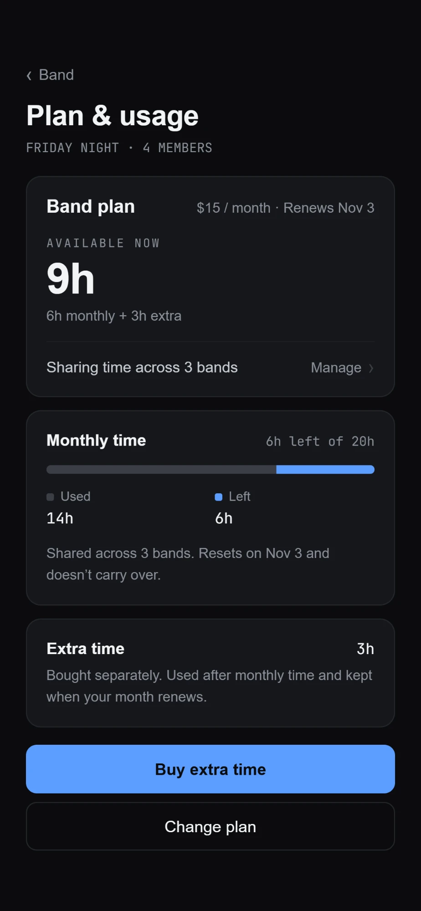

# Take N

밴드 합주를 녹음하려면 곡이 시작하고 끝날 때마다 녹음을 껐다 켜야 하고, 그게 귀찮아서 한 번에 녹음해 두면 나중에 연주 구간을 찾기 어렵다.

Take N은 합주 전체를 녹음해서 올리면 연주 구간(take)만 잘라서 정리해 주는 앱이다. 곡 단위로 잘린 take에 멤버들이 코멘트를 남기며 피드백을 주고받는다.

- Android, iOS 지원
- 스토어 심사 준비 중
- 2026년 8월부터 개발
- 1인 개발

## 기술

- 앱: React-native(Expo), TypeScript
- 서버: NestJS, PostgreSQL (Neon), Drizzle ORM, SQS, Gemini, ffmpeg.
- 인프라: AWS ECS Fargate, ALB, SQS, SSM Parameter Store, CDK (TypeScript), Cloudflare R2
- 개발 환경: Turborepo 모노레포, Docker Compose + LocalStack, Vitest

## 구조

분석 순서: R2 다운로드 → ffmpeg 20분 청크(앞뒤 30초 겹침) → 청크별 Gemini 분석 → 겹침 병합 → take 절단 → 피크 추출(초당 50개, `peaks.bin`) → R2·DB 반영

---

### 폴더 구조

- `apps/mobile` — Expo(React Native) 앱
- `apps/api` — NestJS API와 분석 워커 (`api.main.ts` / `worker.main.ts`, 같은 이미지)
- `apps/audio-worker` — Python 분석 워커 뼈대 (JS 워크스페이스 밖, 자체 pyproject). 검출기 전처리 자리
- `packages/types` — mobile ↔ api 공유 타입 (유일한 공유 지점)
- `packages/api-client` — API 클라이언트
- `packages/config` — 공유 tsconfig/prettier 프리셋
- `poc/` — Phase 0 오디오 세그멘테이션 실험 하네스 (독립)
- `infra/` — AWS CDK 스택과 ECR 푸시 스크립트

## 주요 기능

|                                                                          |                                                                     |
| ------------------------------------------------------------------------ | ------------------------------------------------------------------- |
|                      |               |
| **녹음** 합주를 그대로 녹음한다. 멈추면 바로 업로드와 분석이 이어진다.   | **세션 목록** 분석이 끝나면 take 수, 길이, 코멘트 수가 보인다.      |
|               |               |
| **세션 상세** AI가 잘라낸 take 목록. 파형은 실제 오디오 피크.            | **타임라인** 원본 전체 위에서 take 위치를 보고, 팬·줌·재생.         |
|                   |          |
| **take 편집** 핸들을 끌거나 시간을 입력해 경계를 고친다. 수동 take 추가. | **take 피드백** 시간 위치가 붙은 코멘트와 답글.                     |
|                        |                   |
| **밴드** 멤버와 파트, 초대, 소유권 이전.                                 | **플랜·사용량** 월 분석 시간과 추가 시간. 여러 밴드가 한 풀을 쓴다. |
